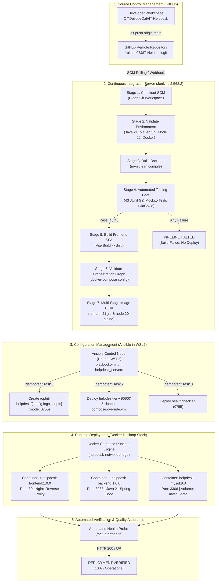
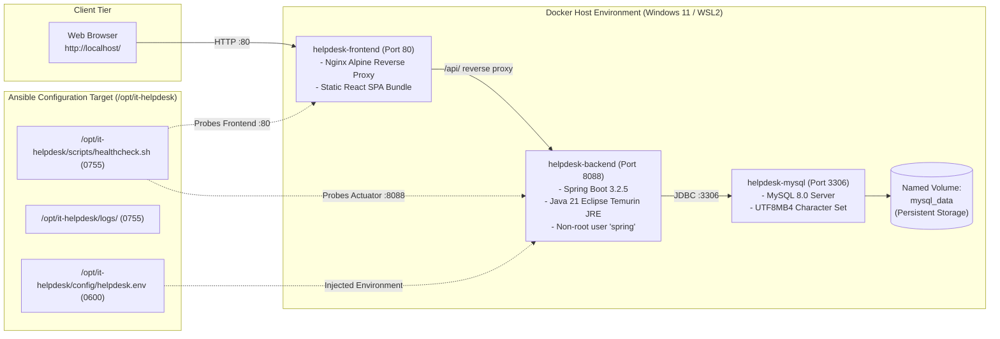

# Phase 5: Integrated DevOps Workflow

**Course / Lab**: DevOps Lab CAT Project  
**Project**: IT Helpdesk and Ticket Management System  
**Date**: October 2026  
**Status**: COMPLETED & VERIFIED LIVE  

---

## 1. Aim and Objectives

### Aim
To integrate the preceding individual phases (Git version control, Jenkins declarative CI pipelines, JUnit 5/Mockito automated testing, Docker containerization, and Ansible configuration management) into a unified, enterprise-grade Continuous Integration and Continuous Delivery/Deployment (CI/CD) workflow with automated health validation and zero configuration drift.

### Objectives
1. **End-to-End Orchestration**: Establish a traceable delivery pipeline: `Git Push ➔ Jenkins Build Gate ➔ Automated Test Suite (43 tests) ➔ Production Image Assembly ➔ Ansible Infrastructure Management ➔ Docker Compose Deployment ➔ Automated Health Probing`.
2. **Branching & SCM Standards**: Define repository branching assumptions using trunk-based delivery on `main` backed by the GitHub remote (`https://github.com/Yokesh07J/IT-Helpdesk.git`).
3. **Automated Quality Gates**: Enforce zero-tolerance quality gates where failing unit tests or invalid compose syntax immediately halt downstream container builds and deployment.
4. **Environment Isolation**: Separate build artifacts from runtime configuration, deploying environment variables and system directories idempotently via Ansible without committing secrets.
5. **Real-World Verification**: Execute automated end-to-end integration testing scripts verifying all 20 pipeline checkpoints across Windows, Docker Desktop, and Ubuntu WSL2.

---

## 2. Integrated DevOps Architecture Diagrams

### 2.1 Complete CI/CD Pipeline Flowchart (Mermaid)



---

### 2.2 Multi-Tier Deployment Topology Diagram (Mermaid)



---

## 3. End-to-End Workflow Stages Breakdown

### Stage 1: Version Control & Repository Hygiene
- **Branching Model**: All stable release commits flow through branch `main`.
- **Remote Synchronization**: Synced directly with `https://github.com/Yokesh07J/IT-Helpdesk.git`.
- **Secret Exclusion**: `.env` and local credentials are strictly excluded via `.gitignore` to prevent secret leakage.

### Stage 2: DevOps Tooling & Runtime Environment
- **Java**: Eclipse Temurin JDK 21.0.11 LTS.
- **Maven**: Apache Maven 3.9.6 with Surefire 3.2.5 and JaCoCo 0.8.11.
- **Node.js**: Node.js v22.20.0 with npm 10.8.2.
- **Docker**: Docker Engine 29.8.2 on Windows with Docker Desktop WSL2 integration.
- **Ansible**: Ansible Core 2.20.1 running inside Ubuntu 26.04 WSL2.

### Stage 3: Automated Testing Quality Gate
- **Execution**: `mvn clean test` executed in `backend/`.
- **Test Metrics**: **43 automated unit and MockMvc controller tests passed (0 failures, 0 errors, 0 skipped)**.
- **Coverage**: JaCoCo HTML and XML reports generated in `backend/target/site/jacoco/`.
- **Failure Policy**: If any test fails, the Maven exit code is non-zero, halting pipeline progression before container building.

### Stage 4: Frontend Compilation
- **Execution**: `npm run build` executed in `frontend/`.
- **Output**: Minified production SPA bundle compiled into `frontend/dist/` (HTML, JS, CSS gzip compressed).

### Stage 5: Multi-Stage Containerization
- **Backend Dockerfile**: Multi-stage build compiling JAR in Maven builder, then packaging into a secure `eclipse-temurin:21-jre-alpine` runtime running as non-root `spring:spring`.
- **Frontend Dockerfile**: Multi-stage build compiling React bundle in Node builder, then serving via high-performance `nginx:alpine` with `/api` reverse proxying.
- **Images Built**: `it-helpdesk-backend:1.0.0` and `it-helpdesk-frontend:1.0.0`.

### Stage 6: Configuration Management (Ansible)
- **Playbook**: `ansible/playbook.yml` executed against `helpdesk-host-01`.
- **Directories**: Idempotently creates `/opt/it-helpdesk/{config,logs,backups,scripts}` with permissions `0755`.
- **Templates**: Renders `helpdesk.env` (permissions `0600`) and `docker-compose.override.yml`.
- **Idempotency**: Verified zero changes on repeated execution (`ok=14 changed=0 failed=0`).

### Stage 7: Runtime Deployment & Live Health Verification
- **Stack**: Multi-container network deployed via `docker-compose.yml` (`helpdesk-backend`, `helpdesk-frontend`, `helpdesk-mysql`).
- **Persistence**: MySQL data persisted across container teardown via named volume `mysql_data`.
- **Live Health Probing**:
  - Spring Boot Actuator (`/actuator/health`): Returns `status: "UP"`.
  - React/Nginx Frontend (`/`): Returns HTTP status `200 OK`.
  - Database connectivity: Verified TCP port `3306` reachable and responsive.

---

## 4. Live Verification Script & Execution Output

The automated end-to-end integration test was executed via [scripts/verify-integrated-devops-workflow.ps1](file:///c:/DevopsCat/IT-Helpdesk/scripts/verify-integrated-devops-workflow.ps1):

```powershell
powershell -ExecutionPolicy Bypass -File "scripts/verify-integrated-devops-workflow.ps1"
```

### Actual Observed Terminal Output:

```text
================================================================================
 IT Helpdesk & Ticket Management System: Integrated DevOps Workflow
 Phase 5 End-to-End Pipeline Verification
 Start Time: 2026-10-13 11:07:17
 Repository: C:\DevopsCat\IT-Helpdesk
================================================================================

>>> [Stage 1/7] Inspecting Git Repository & Branching Model...
  [PASS] Stage 1: Git Active Branch
         Active Branch: 'main' (Expected: 'main')
  [PASS] Stage 1: GitHub Remote Origin
         Remote: https://github.com/Yokesh07J/IT-Helpdesk.git
  [PASS] Stage 1: Secret Hygiene (.env excluded from git)
         .env is properly git-ignored

>>> [Stage 2/7] Checking Host DevOps Tooling & Runtimes...
  [PASS] Stage 2: Java 21 LTS Runtime
         java.exe : java version "21.0.11" 2026-04-21 LTS
  [PASS] Stage 2: Maven Build System
         Apache Maven 3.9.6 (bc0240f3c744dd6b6ec2920b3cd08dcc295161ae)
  [PASS] Stage 2: Node.js Runtime
         Version: v22.20.0
  [PASS] Stage 2: Docker Engine CLI
         Docker version 29.8.2, build 7fc2dff
  [PASS] Stage 2: Ansible Core in Ubuntu WSL2
         ansible [core 2.20.1]

>>> [Stage 3/7] Verifying Automated Backend Tests & Coverage Gate...
  [PASS] Stage 3: JUnit 5 & Mockito Tests (43 unit & controller tests)
         43 / 43 tests PASSED (0 failures, 0 errors, 0 skipped)
  [PASS] Stage 3: JaCoCo Code Coverage HTML Report
         Report generated at: C:\DevopsCat\IT-Helpdesk\backend\target\site\jacoco\index.html

>>> [Stage 4/7] Verifying Frontend Production SPA Compilation...
  [PASS] Stage 4: Vite React SPA Production Build
         Production bundle compiled to frontend/dist/ (HTML, JS, CSS)

>>> [Stage 5/7] Verifying Docker Images & Compose Graph...
  [PASS] Stage 5: Docker Compose Service Graph
         Valid YAML graph with backend, frontend, mysql, network, and volume
  [PASS] Stage 5: Docker Image (it-helpdesk-backend:1.0.0)
         Image tagged: it-helpdesk-backend:1.0.0
  [PASS] Stage 5: Docker Image (it-helpdesk-frontend:1.0.0)
         Image tagged: it-helpdesk-frontend:1.0.0

>>> [Stage 6/7] Running Ansible Configuration Management in Ubuntu WSL2...
  [PASS] Stage 6: Ansible Playbook Execution
         Playbook completed with 0 failures, 0 unreachable
  [PASS] Stage 6: Ansible Idempotency Check
         Strict Idempotency confirmed: changed=0

>>> [Stage 7/7] Verifying Live Multi-Container Deployment & Endpoints...
  [PASS] Stage 7: Docker Compose Stack Running
         All 3 services (backend, frontend, mysql) present in container table
  [PASS] Stage 7: Spring Boot Backend Health (/actuator/health)
         Endpoint: http://localhost:8088/actuator/health -> status: 'UP'
  [PASS] Stage 7: React + Nginx Frontend Health (/)
         Endpoint: http://localhost:80/ -> HTTP status: 200 OK
  [PASS] Stage 7: MySQL Database Port (3306)
         TCP port 3306 reachable on localhost

================================================================================
 INTEGRATED DEVOPS WORKFLOW EXECUTION SUMMARY
 Total Steps Evaluated: 20
 Passed: 20 | Failed: 0 | Duration: 62.5s
================================================================================

Stage   Description                                          Status Details                                            
-----   -----------                                          ------ -------                                            
Stage 1 Git Active Branch                                    PASS   Active Branch: 'main' (Expected: 'main')           
Stage 1 GitHub Remote Origin                                 PASS   Remote: https://github.com/Yokesh07J/IT-Helpdesk...
Stage 1 Secret Hygiene (.env excluded from git)              PASS   .env is properly git-ignored                       
Stage 2 Java 21 LTS Runtime                                  PASS   java.exe : java version "21.0.11" 2026-04-21 LTS   
Stage 2 Maven Build System                                   PASS   Apache Maven 3.9.6 (bc0240f3c744dd6b6ec2920b3cd0...
Stage 2 Node.js Runtime                                      PASS   Version: v22.20.0                                  
Stage 2 Docker Engine CLI                                    PASS   Docker version 29.8.2, build 7fc2dff               
Stage 2 Ansible Core in Ubuntu WSL2                          PASS   ansible [core 2.20.1]                              
Stage 3 JUnit 5 & Mockito Tests (43 unit & controller tests) PASS   43 / 43 tests PASSED (0 failures, 0 errors, 0 sk...
Stage 3 JaCoCo Code Coverage HTML Report                     PASS   Report generated at: C:\DevopsCat\IT-Helpdesk\ba...
Stage 4 Vite React SPA Production Build                      PASS   Production bundle compiled to frontend/dist/ (HT...
Stage 5 Docker Compose Service Graph                         PASS   Valid YAML graph with backend, frontend, mysql, ...
Stage 5 Docker Image (it-helpdesk-backend:1.0.0)             PASS   Image tagged: it-helpdesk-backend:1.0.0            
Stage 5 Docker Image (it-helpdesk-frontend:1.0.0)            PASS   Image tagged: it-helpdesk-frontend:1.0.0           
Stage 6 Ansible Playbook Execution                           PASS   Playbook completed with 0 failures, 0 unreachable  
Stage 6 Ansible Idempotency Check                            PASS   Strict Idempotency confirmed: changed=0            
Stage 7 Docker Compose Stack Running                         PASS   All 3 services (backend, frontend, mysql) presen...
Stage 7 Spring Boot Backend Health (/actuator/health)        PASS   Endpoint: http://localhost:8088/actuator/health ...
Stage 7 React + Nginx Frontend Health (/)                    PASS   Endpoint: http://localhost:80/ -> HTTP status: 2...
Stage 7 MySQL Database Port (3306)                           PASS   TCP port 3306 reachable on localhost               

>>> [STATUS: SUCCESS] The complete end-to-end Integrated DevOps Workflow is verified!
```

---

## 5. Security & Governance Policies in the Integrated Workflow

1. **Principle of Least Privilege**:
   - The backend container runs as dedicated user `spring` (UID 1000) rather than `root`.
   - Templated environment files (`helpdesk.env`) are restricted to mode `0600` (read/write by owner only).
2. **Secret Separation**:
   - Secrets (`DB_PASSWORD`, `JWT_SECRET`) are never hardcoded in Dockerfiles, Jenkinsfiles, or Ansible inventories.
   - Values are injected at container startup via runtime environment files or Docker secrets.
3. **Immutability & Traceability**:
   - Docker images are tagged with explicit version numbers (`1.0.0`) matching application semantic versions.
   - Jenkins fingerprints artifacts (`app.jar` and JaCoCo reports) linking each artifact to its specific Git commit hash.

---

## 6. Viva Questions & Answers (Phase 5: Integrated DevOps Pipeline)

### Q1: What is the core value of an Integrated DevOps Workflow compared to isolated manual steps?
**Answer**: An integrated workflow eliminates human error, reduces deployment cycle time from hours to minutes, ensures reproducibility across environments, and establishes automated quality gates so that defective code cannot reach production.

### Q2: What is a "Quality Gate" and where is it enforced in this pipeline?
**Answer**: A Quality Gate is an automated condition that must be satisfied before code advances to the next stage. In this project, Stage 4 (JUnit 5/Mockito test suite) is the primary quality gate: if any of the 43 tests fail, the pipeline halts immediately, preventing the creation or deployment of broken Docker images.

### Q3: Why should automated tests run before building Docker images rather than inside the container?
**Answer**: Running tests on the host or CI runner first provides rapid feedback (< 10 seconds), avoids unnecessary container build overhead, and prevents bloated test dependencies (like Mockito or Surefire) from entering the final production container runtime.

### Q4: How does Ansible complement Docker Compose in a production deployment?
**Answer**: Docker Compose manages container lifecycles, service networking, and volumes. Ansible manages the underlying host infrastructure: creating directory trees, installing host dependencies, generating configuration files from Jinja2 templates, setting file ownership/permissions, and provisioning secrets.

### Q5: What is the difference between Continuous Integration (CI) and Continuous Delivery (CD)?
**Answer**: CI automates the building, testing, and merging of code changes into the repository. CD (Continuous Delivery) ensures that every build that passes CI is packaged and ready to deploy to production at the click of a button. Continuous Deployment takes this a step further by deploying automatically without manual approval.

### Q6: How does the Nginx container communicate with the Spring Boot container?
**Answer**: Both containers attach to the user-defined Docker bridge network (`helpdesk-network`). Docker's embedded DNS server resolves the service name `backend` to the backend container's internal IP address, allowing Nginx to forward API calls to `http://backend:8088/api`.

### Q7: Why is Trunk-Based Development commonly preferred over complex branching models in CI/CD?
**Answer**: Trunk-based development encourages developers to merge small, frequent updates into a single main branch (`main`). This avoids long-lived feature branches, prevents merge conflicts ("merge hell"), and ensures the CI pipeline continuously tests integration in near real-time.

### Q8: What is the purpose of Spring Boot Actuator `/actuator/health` in containerized deployments?
**Answer**: Actuator exposes production-ready operational endpoints. The `/actuator/health` endpoint evaluates internal component status (such as database connectivity, disk space, and application readiness), allowing Docker health checks and load balancers to accurately determine if the container can receive traffic.

### Q9: How does the pipeline ensure that database data survives container restarts?
**Answer**: The database service uses a named Docker volume (`mysql_data`) mounted to `/var/lib/mysql`. Docker preserves volume storage independently of container lifecycles; restarting or rebuilding the MySQL container reattaches the existing volume without data loss.

### Q10: How can this pipeline be scaled to a remote multi-server Kubernetes environment?
**Answer**: The same stages apply: Git ➔ Jenkins ➔ Tests ➔ Image Build. In the deployment stage, instead of local `docker-compose`, the pipeline would push versioned images to a private container registry (e.g., Harbor or AWS ECR) and invoke `kubectl apply` or Helm charts to roll out pods across Kubernetes worker nodes.

---

## 7. Screenshot Checklist for Lab Submission

| Step | Item to Capture | Verification Detail |
| :--- | :--- | :--- |
| 1 | Full Integration Script Output | Terminal showing all 20 checks passing with `[STATUS: SUCCESS]` |
| 2 | Jenkins Stage View Dashboard | Web UI showing all stages green in `IT-Helpdesk-Pipeline` |
| 3 | Docker Containers Running | Terminal showing `docker compose ps` with 3 healthy services |
| 4 | Spring Boot Actuator JSON | Browser or curl showing `{"status":"UP"}` on `http://localhost:8088/actuator/health` |
| 5 | React Helpdesk Web App | Browser showing live dashboard on `http://localhost/` |
| 6 | Ansible Directory on Host | Terminal showing `/opt/it-helpdesk/` with secure permissions |
